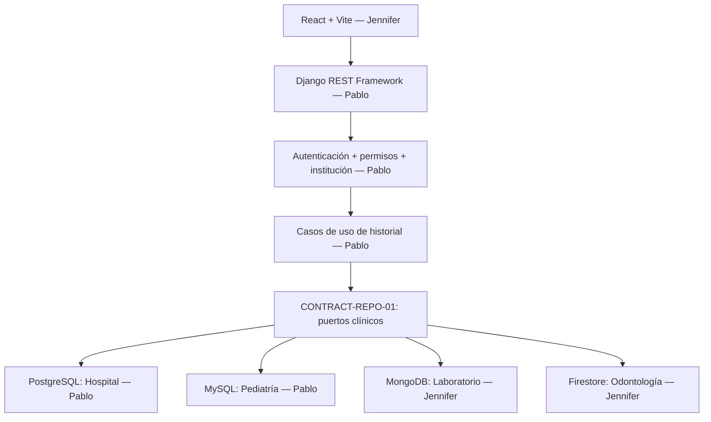

# PLAN_MAESTRO.md — Red de Instituciones Médicas

> **Versión:** 1.0 — 2026-10-20
> **Repositorio:** https://github.com/PabloZ7-425/Red_Instituciones_Medicas
> **Base auditada:** `main` en `434968295c77b1ba5b3fa96f9f11d367c5a7c835` (commit del 2026-10-06).
> **Estado de este documento:** planificación y contratos **propuestos**; ninguno se considera aprobado hasta completar el *Gate Fase 0*.
> **Documentos complementarios:** [`GUIA_PABLO_AGENTES.md`](./GUIA_PABLO_AGENTES.md) y [`GUIA_JENNIFER_AGENTES.md`](./GUIA_JENNIFER_AGENTES.md).

## 1. Objetivo, límites y evidencia de partida

Implementar una aplicación cliente-servidor única para administrar historiales clínicos de cuatro instituciones. Al iniciar sesión, el backend selecciona automáticamente el motor correspondiente a la institución del usuario, **sin confiar en un motor o institución elegidos por el navegador**. Las reglas de negocio se expresan en una capa común (arquitectura hexagonal) y cada motor implementa la persistencia pertinente.

**Exigencias oficiales de la Entrega II:** aplicación funcional; conexión cliente-servidor; modelos corregidos de la Entrega I; consultas equivalentes en los cuatro motores; MongoDB y Firestore con decisiones explícitas de embebido/referencia; interfaz ordenada y consistente; crear pacientes; mantener historiales (consultas, diagnósticos, tratamientos y recetas); archivar/desactivar historiales; selección de motor al autenticarse; documento comparativo de decisiones de modelado, consistencia, transacciones, seguridad y asignación. La Entrega I también solicita modelo ER y relacional de los motores SQL, entidades/atributos, clasificación de información y normalización.

**Asignación aprobada previamente:**

| Institución | Motor | Responsable |
|---|---|---|
| Hospital general | PostgreSQL 16 | **Pablo** |
| Centro médico pediátrico | MySQL 8.4 | **Pablo** |
| Laboratorio clínico | MongoDB 7 | **Jennifer** |
| Clínica odontológica | Firestore (emulador local) | **Jennifer** |

**Alcance común obligatorio:** registrar/buscar pacientes; ver historial; registrar consulta, diagnóstico, tratamiento y receta; archivo lógico con motivo; autenticación, autorización y aislamiento institucional. **Alcance especializado**, como evidencia del caso: hospital (ingreso, cama, alta y atención), pediatría (tutor, vacunas, crecimiento), laboratorio (órdenes, muestras y resultados variables), odontología (citas, piezas/procedimientos y pagos administrativos). Priorizar el flujo clínico común antes de especializaciones secundarias.

**Fuera del alcance obligatorio:** sistema hospitalario productivo, expedientes reales, facturación electrónica, pasarela de pagos, réplica multi-nodo/alta disponibilidad empresarial, balanceadores y despliegue público. Triggers, auditoría y respaldos son mejoras justificadas por lo visto en clase, **no reemplazan** ninguna función exigida.

### 1.1 Inventario del repositorio auditado

| Ruta | Lo que existe | Límite actual comprobado en código |
|---|---|---|
| `docker-compose.yml` | PostgreSQL, MySQL, MongoDB, Firestore, backend, frontend y Adminer | Configura servicios; **no prueba** por sí solo que estén corriendo en ambos equipos. |
| `db/postgres/init.sql` | Tablas de hospital con FKs y restricciones | No hay casos de uso API para escribir/leer historias. |
| `db/mysql/init.sql` | Tablas pediátricas con FKs y restricciones | No hay casos de uso API para escribir/leer historias. |
| `db/mongo/init.js` | `usuarios`, `pacientes`, `consultas`, `medicamentos`, `tipos_examen`, `resultados_examen` | Validadores e índices iniciales, sin CRUD desde Django. |
| `db/firebase/firebase.json` | Emulador Firestore + UI | Sin colecciones/fixtures de odontología ni política de exportación/importación. |
| `backend/apps/historiales/domain/ports.py` | Puerto de salud y repositorio clínico mínimo | Métodos clínicos no están implementados en los adaptadores. |
| `backend/apps/historiales/infrastructure/adapters/` | 4 clases de conexión | Cada una solo implementa `health_check()`. |
| `backend/apps/historiales/presentation/` | `/api/`, `/api/health/`, `/api/health/databases/` | No hay login ni endpoints clínicos. |
| `frontend/src/pages/HomePage.jsx` | Panel de salud de conexiones | No hay login, pacientes ni historial. |
| `backend/apps/historiales/tests.py` | Prueba de `/api/health/` | No prueba contratos ni motores. |
| `backend/db.sqlite3` | Archivo binario **versionado** | Contradice `CONTRIBUTING.md`; retirar del índice de Git en PR separado. |
| `.gitignore` | Excluye `.env`, node_modules y otros | No excluye explícitamente `db.sqlite3` hoy. |

**Observaciones de riesgo inicial:** el comando actual de MongoDB ejecuta un `mongod` independiente, no un replica set; las transacciones multidocumento requieren evaluar y configurar replica set si se necesitan. El backend usa SQLite para tablas internas de Django; no confundirlo con un quinto motor institucional. Los scripts `docker-entrypoint-initdb.d` de SQL se aplican al crear volúmenes vacíos, no al levantar contenedores existentes. Los puertos de desarrollo se publican solo en `127.0.0.1`; Firestore externo es `8082` y UI `4000`.

## 2. Gobierno, propiedad y comunicación

**Célula A — Jennifer + agentes IA:** frontend React, MongoDB, Firestore, adaptadores NoSQL, mocks/frontend, pruebas documentales, documentación NoSQL.
**Célula B — Pablo + agentes IA:** dominio y casos de uso, contratos compartidos bajo aprobación cruzada, Django/DRF, autenticación y enrutamiento, PostgreSQL, MySQL, adaptadores SQL, API y documentación SQL.

| Zona | Dueño de escritura | Revisión | Restricción |
|---|---|---|---|
| `frontend/**` | A | B si hay contrato/API | B no modifica componentes. |
| `db/mongo/**`, `db/firebase/**` | A | B | B no cambia inicializadores documentales. |
| `.../adapters/mongo_adapter.py`, `firestore_adapter.py` | A | B | A implementa el contrato de repositorio. |
| `db/postgres/**`, `db/mysql/**` | B | A | A no cambia SQL. |
| `.../adapters/postgres_adapter.py`, `mysql_adapter.py` | B | A | B implementa el contrato. |
| `backend/apps/historiales/domain/**` | B | **A aprueba contratos** | ⚠️ requiere acuerdo A↔B para romper contratos. |
| `backend/apps/historiales/application/**`, `.../presentation/**`, `backend/config/**` | B | A | B entrega API estable. |
| `.../infrastructure/factory.py` | B | A | A no añade ruteo alternativo. |
| `docker-compose.yml`, `.env.example`, `.gitignore`, `README.md`, `.github/**`, documentos raíz | Compartido; **un único dueño por PR** | Ambos | No editar simultáneamente; reservar por issue/PR. |
| Pruebas nuevas | Cada dueño en archivos distintos | Otra célula | B mantiene `tests.py` existente; A no lo reemplaza. |

**Regla:** nunca abrir dos PR activos que editen el mismo archivo compartido. Si una célula lo necesita, crea solicitud especificando archivo, motivo y prueba; el dueño temporal lo edita en un PR coordinado. No hay cambios directos sobre `main`.

## 3. Arquitectura objetivo



El frontend solo conoce `CONTRACT-API-01`; los casos de uso solo conocen `CONTRACT-REPO-01`. La fábrica selecciona adaptador **por institución autenticada**. Los campos especiales pueden existir en extensiones por institución, sin cambiar el contrato común del historial.

## 4. Decisiones requeridas en Fase 0 (todavía no aprobadas)

| ID | Responsable que propone | Decisión concreta / criterio | Riesgo si se omite |
|---|---|---|---|
| `D0-01` | B, aprobación A | Forma de autenticación (sesión/cookie + CSRF o token); estrategia de logout y expiración | Interfaz y API incompatibles. |
| `D0-02` | B, aprobación A | Ubicación del directorio central de usuarios: preferencia técnica PostgreSQL de autenticación, explicando claramente su función frente al requisito de motores separados; verificar aceptación académica. No usar SQLite para datos institucionales. | Interpretación ambigua de la restricción de motores. |
| `D0-03` | B, aprobación A | Matriz de roles y permisos común + mapeo a roles existentes de cada institución | Accesos indebidos. |
| `D0-04` | B, aprobación A | Esquemas y código de errores del contrato API, versionado sin cambios unilaterales | Fallas silenciosas frontend-backend. |
| `D0-05` | A, aprobación B | Identificadores externos `string`, tipos de fechas y zona horaria de respuestas | Errores en `ObjectId`, IDs SQL y fechas. |
| `D0-06` | A, aprobación B | Entidades embebidas/referenciadas y tamaños de documentos NoSQL | Consultas deficientes o crecimiento descontrolado. |
| `D0-07` | B, aprobación A | Límite de transacción por caso de uso y modelo de errores/reintentos | Escrituras parciales. |
| `D0-08` | A, aprobación B | Estrategia de desarrollo para Firestore: inicialización y persistencia/exportación reproducibles | Datos demo desaparecen al reiniciar. |
| `D0-09` | B, aprobación A | Herramientas de tests y lint realmente instaladas; no exigir Ruff/Black/ESLint antes de configurarlos | PRs bloqueados por comandos inexistentes. |
| `D0-10` | Ambos | Prioridad final de especializaciones clínicas y evidencia de Entrega I disponible fuera del repositorio | Rehacer modelos sin retroalimentación del profesor. |

## 5. Contratos v1 **propuestos**

> Los nombres de rutas y payloads siguientes son **propuestas para ratificar en Fase 0**. Tras ratificación se convierten en `CONTRACT-API-01@1.0` y `CONTRACT-REPO-01@1.0`; los agentes no pueden inventar campos, renombrar rutas, códigos ni modificar semántica sin PR `contract/*` aprobado por ambos.

### 5.1 `CONTRACT-API-01` — exactamente 10 operaciones iniciales

Prefijo: `/api/`. Para las operaciones clínicas, la institución se obtiene exclusivamente del usuario autenticado. Las respuestas clínicas no revelan credenciales ni detalles internos del motor.

| ID | Método | Ruta propuesta | Entrada mínima | Resultado mínimo | Dueño |
|---|---|---|---|---|---|
| `API-01` | POST | `/api/auth/login/` | credenciales según `D0-01` | sesión/token, usuario autorizado e institución | B |
| `API-02` | GET | `/api/auth/me/` | autenticación | usuario, rol, institución | B |
| `API-03` | GET | `/api/pacientes/` | filtro opcional `q`, paginación acordada | colección paginada de pacientes | B (API), A (UI) |
| `API-04` | POST | `/api/pacientes/` | `PacienteCreate` | paciente creado + `id` | B (API), A/B (adaptadores) |
| `API-05` | GET | `/api/pacientes/{id}/historial/` | id del paciente | paciente + consultas, diagnósticos, tratamientos, recetas | B (API), A/B (adaptadores) |
| `API-06` | POST | `/api/pacientes/{id}/consultas/` | `ConsultaCreate` | consulta creada | B (API), A/B (adaptadores) |
| `API-07` | POST | `/api/consultas/{id}/diagnosticos/` | `DiagnosticoCreate` | diagnóstico creado | B (API), A/B (adaptadores) |
| `API-08` | POST | `/api/diagnosticos/{id}/tratamientos/` | `TratamientoCreate` | tratamiento creado | B (API), A/B (adaptadores) |
| `API-09` | POST | `/api/tratamientos/{id}/recetas/` | `RecetaCreate` | receta creada | B (API), A/B (adaptadores) |
| `API-10` | PATCH | `/api/pacientes/{id}/estado/` | `{ "estado":"archivado", "motivo":"..." }` | paciente archivado + fecha | B (API), A/B (adaptadores) |

**Sesiones:** al decidir `D0-01`, documentar mecanismo seguro de cierre de sesión, invalidación y CSRF según corresponda; puede requerir una ruta adicional en una versión aprobada, sin atribuirla falsamente a las 10 operaciones del núcleo clínico.

**Convenciones propuestas:** `id` externo **string** (incluye IDs SQL serializados); fechas sin hora `YYYY-MM-DD`; timestamps UTC ISO-8601 con sufijo `Z`, mostrados localmente por React; `identificacion` string, nunca número; UTF-8; JSON sin contraseñas ni detalles de servidor. El término `institucion` en las respuestas tiene los slugs existentes: `hospital`, `pediatrico`, `laboratorio`, `odontologica`.

Ejemplo **ficticio** de creación; no contiene datos reales:

```json
{
  "identificacion": "DEMO-0001",
  "nombres": "Paciente",
  "apellidos": "Ejemplo",
  "fecha_nacimiento": "2001-02-03"
}
```

Ejemplo **propuesto** de envoltorio de error (ratificar con `D0-04`):

```json
{
  "error": {
    "code": "VALIDATION_ERROR",
    "message": "Datos inválidos",
    "fields": {"identificacion": ["Este campo es obligatorio"]}
  }
}
```

Códigos candidatos: `VALIDATION_ERROR` (400), `UNAUTHORIZED` (401), `FORBIDDEN` (403), `NOT_FOUND` (404), `CONFLICT` (409), `INTERNAL_ERROR` (500). **No están implementados todavía**. `404` puede preferirse a `403` para no revelar la existencia de pacientes ajenos; resolver en `D0-04`. Para cada operación definir en C0 un ejemplo válido, uno inválido, y reglas de autorización.

### 5.2 `CONTRACT-REPO-01` — puerto clínico propuesto en Python

Este boceto formaliza responsabilidades; Pablo lo consolidará en `domain/ports.py` después de la revisión A. **No pegar como código definitivo sin diseñar DTOs y errores**, y no mezclar puertos clínicos con `DatabaseAdapter.health_check`.

```python
from abc import ABC, abstractmethod
from collections.abc import Mapping
from typing import Any

JsonMap = Mapping[str, Any]

class HistorialRepository(ABC):
    @abstractmethod
    def registrar_paciente(self, paciente: JsonMap) -> JsonMap: ...

    @abstractmethod
    def listar_pacientes(self, *, q: str = "", limit: int = 20, offset: int = 0) -> JsonMap: ...

    @abstractmethod
    def obtener_historial(self, paciente_id: str) -> JsonMap: ...

    @abstractmethod
    def registrar_consulta(self, paciente_id: str, consulta: JsonMap) -> JsonMap: ...

    @abstractmethod
    def registrar_diagnostico(self, consulta_id: str, diagnostico: JsonMap) -> JsonMap: ...

    @abstractmethod
    def registrar_tratamiento(self, diagnostico_id: str, tratamiento: JsonMap) -> JsonMap: ...

    @abstractmethod
    def registrar_receta(self, tratamiento_id: str, receta: JsonMap) -> JsonMap: ...

    @abstractmethod
    def archivar_paciente(self, paciente_id: str, motivo: str) -> JsonMap: ...
```

**Reglas del puerto:** cada método devuelve IDs externos string, respeta la institución del repositorio seleccionado, es atómico en el límite definido, no pierde relaciones clínicas y traduce errores de persistencia a errores de dominio. El `factory.py` no recibe un nombre arbitrario de motor del frontend. Los CRUD especializados de cada institución se añaden mediante interfaces separadas (`HospitalService`, `PediatriaService`, `LaboratorioService`, `OdontologiaService`) **solo si son necesarios**; no forzar un método genérico lleno de campos nulos.

### 5.3 Fixtures, prueba de contrato y seguridad

- Datos de prueba: exclusivamente nombres, identificaciones y resultados sintéticos (`DEMO-*`), repetibles y sin información clínica real.
- Una batería de pruebas comunes debe comprobar `registrar_paciente`, `listar_pacientes`, `obtener_historial`, `registrar_consulta`, diagnóstico, tratamiento, receta, archivo y aislamiento. La implementación corre contra cada adaptador con setup/teardown de prueba sin eliminar volúmenes de los compañeros.
- La prueba SQL que usa varias sentencias debe demostrar rollback; en MongoDB/Firestore deben elegirse operaciones que realmente requieran atomicidad y soporten su mecanismo de transacción.
- La clasificación de información debe distinguir **pública, confidencial y restringida** de acuerdo con el documento del curso; añadir categoría interna cuando ayude, sin cambiar las exigidas.
- No enviar resultados clínicos completos a logs ni exponer secretos o datos de pacientes en URLs públicas.

## 6. Fases y criterios verificables de cierre

| Fase / épica | Actividades principales | Gate de salida (evidencia objetiva) |
|---|---|---|
| **F0 · `EPIC-00`** Contratos y sincronización | Confirmar commit, salud de 4 BD, decisiones `D0-*`, aprobar contratos, mocks | Ambos firman checklist de 11 ítems del apartado 12.1 y las guías de cada célula; contrato versionado; comandos basales ejecutados en **ambos** equipos. |
| **F1 · `EPIC-01`** Seguridad/modelos | B autenticación/autorización y verificación SQL; A esquema Firestore, refinamiento Mongo | Usuario ligado a institución; documentos/fixtures NoSQL validados; matrices de acceso definidas; no elección de motor desde UI. |
| **F2 · `EPIC-02`** Persistencia | B adaptadores PostgreSQL/MySQL; A MongoDB/Firestore | Pruebas comunes de CRUD clínico pasan para los 4 motores; se prueban búsquedas y archivo lógico. |
| **F3 · `EPIC-03`** Aplicación cliente-servidor | B API; A React con mocks y luego integración real | Usuario inicia sesión y ejecuta flujo completo desde React para cada institución; errores y permisos correctos. |
| **F4 · `EPIC-04`** Confiabilidad y curso | Transacciones, validaciones, auditoría justificada, índices, backup/restore | Prueba de error intermedio sin estado parcial; acceso cruzado denegado; restauración demo verificada sin tocar datos reales. |
| **F5 · `EPIC-05`** Documentación/entrega | Comparativo y decisiones; modelos actualizados; evidencia; demos | Requisitos cotejados uno por uno; documentos coherentes con código; demostración reproducible. |

> Dependencias: F0 bloquea cualquier implementación que afecte contratos. F1 modelos y autenticación pueden avanzar en paralelo. F2 por motor avanza en paralelo después de F0. React con mocks puede comenzar en C0/C1. La integración de API requiere contrato aprobado y al menos un adaptador probado. F4 puede agregar tests durante todas las fases, pero no desplazar los CRUD obligatorios.

## 7. Ciclos integrados C0–C9 y PRs previstos

Los ciclos **no son semanas ni fechas fijas**; un ciclo cierra al verificar su gate. Los identificadores `PR-*` son **referencias del plan**, no números reales asignados por GitHub.

| Ciclo | Célula A: Jennifer | Célula B: Pablo | Integración y PRs previstos |
|---|---|---|---|
| **C0** | `A-C0-T1` revisar API/puerto y preparar mocks conforme contrato | `B-C0-T1` redactar, probar y cerrar contratos + decisiones | `PR-02` B (borrador → revisión A → merge), luego `PR-01` A; **contrato ratificado** |
| **C1** | `A-C1-T1` modelado inicial de Firestore + datos demo | `B-C1-T1` autenticación/autorización institucional | `PR-03`, `PR-04`; acceso institucional y modelo dental |
| **C2** | `A-C2-T1` refinar MongoDB, validadores e índices | `B-C2-T1` revisar SQL, índices, normalización y migraciones | `PR-05`, `PR-06`; modelos listos |
| **C3** | `A-C3-T1` adaptador MongoDB con CRUD de contrato | `B-C3-T1` adaptador PostgreSQL con CRUD | `PR-07`, `PR-08`; primeras pruebas cruzadas |
| **C4** | `A-C4-T1` adaptador Firestore con CRUD de contrato | `B-C4-T1` adaptador MySQL con CRUD | `PR-09`, `PR-10`; cuatro motores comparables |
| **C5** | `A-C5-T1` React pacientes/historial con mocks | `B-C5-T1` endpoints clínicos DRF conectados a casos de uso | `PR-11`, `PR-12`; primer flujo integrado |
| **C6** | `A-C6-T1` conexión real React ↔ API + casos especializados UI prioritarios | `B-C6-T1` autorización, validaciones y endpoints especializados prioritarios | `PR-13`, `PR-14`; flujo de 4 instituciones |
| **C7** | `A-C7-T1` transacciones, auditoría y seguridad NoSQL | `B-C7-T1` transacciones, auditoría y seguridad SQL | `PR-15`, `PR-16`; fallos controlados |
| **C8** | `A-C8-T1` pruebas E2E UI y recuperación NoSQL | `B-C8-T1` pruebas de API e integración + restauración SQL | `PR-17`, `PR-18`; validación reproducible |
| **C9** | `A-C9-T1` documentación y pruebas finales NoSQL/React | `B-C9-T1` documentación y pruebas finales SQL/backend | `PR-19`, `PR-20`; entrega revisada |

**Arranque documental anterior a C0:** `PR-00` (rama `docs/plan-operativo`): añade **solo** estos 3 `.md`, responsable temporal A, revisión B. Se integra a `main` antes de iniciar PR-01/02 para que todos los agentes lean la misma versión. No se ha creado ni subido todavía.

## 8. Git y PR: flujo seguro

```powershell
# Ambos, al iniciar desde un clon limpio (PowerShell)
git clone https://github.com/PabloZ7-425/Red_Instituciones_Medicas.git
cd Red_Instituciones_Medicas
git fetch origin
git switch main
git pull --ff-only origin main
git rev-parse HEAD
git status --short

# Crear rama solo después de acordar PR/tarea
git switch -c feature/jenni-c1-firestore-model
# ... editar exclusivamente archivos asignados ...
git add db/firebase
# Examinar los cambios antes de confirmar
git diff --cached --stat
git commit -m "feat(firestore): definir modelo dental inicial"
git push -u origin feature/jenni-c1-firestore-model
# Abrir PR en GitHub contra main y solicitar revisión a Pablo
```

Pablo usa una rama `feature/pablo-*`; para contratos compartidos `contract/api-repo-v1` y revisión obligatoria A. Un PR = una tarea `A-Cn-Tn` o `B-Cn-Tn`; **PR-00** es excepción administrativa de arranque. No usar `git push --force` sobre ramas compartidas ni `git merge` directo a `main` sin revisión. Resolver conflictos primero actualizando con `main` y coordinando la propiedad del archivo. Si se rompe contrato: abrir issue con prefijo `contract-violation`, marcar dependencia, **no** editar el código ajeno por cuenta propia.

**Definición de listo para empezar (DoR):** contrato y entradas disponibles, archivos asignados, dependencia explícita, fixture ficticio, prueba de aceptación acordada.
**Definición de terminado (DoD):** funcionalidad y pruebas; no secretos; cambios acotados; documentación pertinente; salida exacta de comandos registrada; revisión cruzada aprobada; merge confirmado en `main` y sincronización del otro equipo.

## 9. Pruebas: comandos reales de base vs comandos futuros

### Baseline actual — ejecutar en **cada equipo**, no borrar volúmenes

```powershell
# En raíz del repositorio, después de copiar .env.example a .env
docker compose config -q
docker compose up --build -d
docker compose ps -a
curl.exe -f http://localhost:8000/api/health/
curl.exe -f http://localhost:8000/api/health/databases/
docker compose exec -T backend python manage.py check
docker compose exec -T backend python manage.py test apps.historiales
docker compose exec -T frontend npm run build
```

`curl` al endpoint de bases debe devolver `connected: true` en las cuatro instituciones; un `200` de `/api/health/` solo verifica Django. Si un comando falla, registrar error, contenedor y logs relevantes con datos sensibles redactados: `docker compose logs --tail=100 backend`, etc. **No ejecutar `docker compose down -v`** salvo decisión explícita de destruir datos locales y respaldo previo.

### Pruebas que se incorporarán con los PRs (no existen todavía)

- **B**: tests de autenticación, autorización, dominio, serializadores y adaptadores SQL mediante `python manage.py test apps.historiales` u objetivos puntuales incorporados por PR.
- **A**: pruebas de adaptadores MongoDB/Firestore por el mismo comando de Django; pruebas del código frontend cuando se agreguen scripts a `frontend/package.json`; `npm run build` ya es válido. No exigir `npm run lint`, `pytest`, `ruff`, `black` ni `npm test` **hasta agregar su configuración en PR revisado**.
- **Ambos**: pruebas de contrato parametrizadas contra 4 motores; 401/403/404, validación 400, conflicto 409 según el contrato final; fixtures/limpieza de prueba; abortos transaccionales; restauración en entornos separados.

## 10. Matriz de riesgos y prioridades

| Riesgo | Impacto | Responsable de mitigación | Respuesta |
|---|---|---|---|
| Contrato sin aprobar | Todo el equipo bloqueado | B propone / A aprueba | Cerrar F0 antes de adaptadores/UI real. |
| SQLite rastreado en Git | Conflictos, datos locales versionados | B, PR separado | `git rm --cached backend/db.sqlite3` + `.gitignore` actualizado, sin borrar copia de trabajo. |
| Diferencia entre SQL y NoSQL | Operaciones inconsistentes | Ambos | Contrato común + fixtures y tests por motor. |
| Firestore pierde datos de demo | Demostración irreproducible | A | Seed reproducible + export/import del emulador. |
| Mongo sin replica set | No hay transacciones multidocumento | A solicita cambio compartido coordinado con B | Decidir límite transaccional antes de tocar Compose. |
| Migraciones destruyen datos | Pérdida de trabajo local | B SQL / A NoSQL | Scripts incrementales o migraciones idempotentes, respaldos y no `down -v`. |
| Fuga clínica entre instituciones | Incumplimiento de seguridad | B en API + A en pruebas | Derivar institución de sesión y test de aislamiento. |
| Dependencias de tooling inexistentes | Bloqueo artificial de PR | Ambos | Baseline real; introducir lint/tests gradualmente. |
| Funciones extra antes de CRUD | Retraso en rúbrica | Ambos | Priorizar historia clínica mínima primero. |
| Documentación no alineada | Entrega incompleta | Ambos | Comparativo con evidencia y decisiones actualizadas. |

## 11. Matriz de aceptación vinculada a la rúbrica

| ID | Requisito del proyecto | Evidencia a conservar | Fase |
|---|---|---|---|
| `REQ-01` | 4 instituciones, 4 motores distintos | Configuración + tabla justificada | F0/F5 |
| `REQ-02` | Aplicación cliente-servidor funcional | Flujo completo React → Django → motor | F3 |
| `REQ-03` | Modelos relacionales corregidos y normalizados | Diagramas, scripts, observaciones del profesor | F1/F5 |
| `REQ-04` | Modelo MongoDB/Firestore embebidos/referencias | Diagramas/documentos + explicación | F1/F5 |
| `REQ-05` | Consultas equivalentes en motores | Batería de contrato contra 4 adaptadores | F2 |
| `REQ-06` | Alta de paciente nuevo | Evidencia API/UI en cada institución | F2/F3 |
| `REQ-07` | Historial existente + consulta, diagnóstico, tratamiento, receta | Demostración y pruebas persistencia | F2/F3 |
| `REQ-08` | Archivo/baja del paciente | Operación con motivo, historial preservado | F2/F3 |
| `REQ-09` | Enrutamiento por usuario autenticado | Prueba aislamiento sin selector de motor | F1/F3 |
| `REQ-10` | Visualización ordenada, interfaz consistente | Capturas/recorrido cuatro instituciones | F3 |
| `REQ-11` | Documento comparativo motores/consistencia/seguridad | Documento breve y verificable | F5 |
| `REQ-12` | Clasificación pública/confidencial/restringida | Matriz datos por institución | F5 |

## 12. Primer arranque compartido y estado que debe registrar cada uno

1. Integrar **PR-00** con estos 3 documentos. Ambos actualizan `main` y apuntan el mismo SHA de referencia en la ficha de coordinación. El SHA inicial auditado `4349682` cambiará cuando se fusione PR-00: **no exigir que siga siendo igual**.
2. En cada equipo: abrir Docker Desktop, copiar `.env.example` a `.env` **solo si no existe**, configurar claves locales distintas de los ejemplos, ejecutar comandos del apartado 9.
3. Abrir `http://localhost:5173`, `http://localhost:8000/api/health/databases/`, `http://localhost:4000`, `http://localhost:8081`; verificar qué funciona. El emulador Firestore se publica en `8082` para API desde host; dentro del backend sigue `firestore:8080`.
4. Registrar por persona: SHA, `docker compose ps -a`, estado de salud de 4 motores, prueba Django y build React. No pegar contraseñas ni `.env`.
5. Si los dos entornos están listos, ejecutar checklist de 11 ítems del apartado 12.1; **recién entonces** activar ramas de implementación C1.

### 12.1 Gate de Fase 0: 11 casillas que AMBOS deben aprobar

- [ ] `G0-01` Ambos pueden clonar/actualizar `main` y anotaron su SHA (tras PR-00).
- [ ] `G0-02` Ambos tienen `.env` local no versionado con valores seguros de desarrollo.
- [ ] `G0-03` `docker compose config -q` termina sin errores en los dos equipos.
- [ ] `G0-04` Los contenedores principales se levantan sin fallo en los dos equipos.
- [ ] `G0-05` `/api/health/databases/` informa conexión de los cuatro motores en los dos equipos.
- [ ] `G0-06` `python manage.py check` y `python manage.py test apps.historiales` pasan en ambos equipos.
- [ ] `G0-07` `npm run build` pasa en ambos equipos.
- [ ] `G0-08` Decisiones `D0-01` a `D0-05` ratificadas y registradas por A y B.
- [ ] `G0-09` Decisiones `D0-06` a `D0-10` ratificadas y registradas por A y B.
- [ ] `G0-10` `CONTRACT-API-01@1.0` y `CONTRACT-REPO-01@1.0` aprobados, con ejemplo válido, inválido y errores.
- [ ] `G0-11` PR-00 integrado; archivos reservados, responsables y primera pareja de tareas/PR acordados.

**Gate F0:** sin las once casillas comprobadas no se modifican rutas ni puertos de las implementaciones de C1–C4. Se permite investigación, mocks y datos ficticios en archivos propios, etiquetados como pendientes de contrato.

### Comandos PowerShell para iniciar sin pisar configuración existente

```powershell
# Desde la carpeta del repositorio
if (-not (Test-Path .env)) { Copy-Item .env.example .env }
notepad .env
# Editar y guardar claves locales. No hacer commit de .env.
docker compose config -q
docker compose up --build -d
docker compose ps -a
```

**Avisos:** en `README.md` se menciona `hc_mongo_init` como contenedor esperado, pero el `docker-compose.yml` auditado no define ese servicio; corregir la documentación, no perseguir un servicio inexistente. Los esquemas SQL no se vuelven a ejecutar si sus volúmenes tienen datos previos. Si alguien ya tiene el proyecto levantado, no destruir sus datos para alinearse: sincronizar código y usar migraciones/semillas no destructivas.

---

**Principio rector:** PRs pequeños, contratos estables y pruebas verificables antes que velocidad de implementación.


---

## Anexo — ADR-ORM-01: estrategia de persistencia híbrida (decisión incorporada el 2026-10-20)

**Estado:** Jennifer acepta esta orientación técnica; **Pablo debe revisarla y ratificarla en la Fase 0** antes de ejecutar migraciones o modificar configuraciones. No reemplaza ninguna de las decisiones `D0-01` a `D0-10` ni cambia los ciclos o PR ya definidos. Forma parte de la discusión de `D0-02` (ubicación de identidad), `D0-07` (transacciones) y `G0-08` (ratificación).

### Alcance preciso de cada tecnología

| Datos / responsabilidad | Herramienta acordada | Responsable | Regla |
|---|---|---|---|
| Usuarios, credenciales, permisos, grupos, sesiones y administración **interna** de Django | **Django ORM** y autenticación nativa de Django | Pablo/B | Usar hashing y permisos de Django; no implementar login duplicado por motor ni guardar contraseñas clínicas en cuatro fuentes. |
| Hospital general — PostgreSQL | **`psycopg` y SQL parametrizado** | Pablo/B | Reutilizar `db/postgres/init.sql` y trabajar desde el adaptador; no crear modelos ORM para las tablas clínicas. |
| Centro pediátrico — MySQL | **`mysql-connector-python` y SQL parametrizado** | Pablo/B | Reutilizar `db/mysql/init.sql`; mantener integridad y transacciones explícitas. |
| Laboratorio — MongoDB | **`pymongo`** | Jennifer/A | Colecciones/documentos; no añadir ODM ni Django ORM para datos clínicos. |
| Odontología — Firestore | **SDK oficial de Firestore** | Jennifer/A | Colecciones/documentos; no añadir ODM ni Firebase Authentication paralela. |
| React | Consumo de `CONTRACT-API-01` | Jennifer/A | No conoce ORM, SQL, `ObjectId`, cliente Firestore ni topología interna. |

**Motivo:** ya existen esquemas SQL extensos y adaptadores con drivers nativos; convertir las tablas clínicas a modelos Django obligaría a mapear esquemas/migraciones ajenos sin beneficio claro para la rúbrica. El profesor evalúa especialmente modelado, consistencia y seguridad; SQL parametrizado, transacciones y restricciones explícitas son adecuados para demostrarlo. La arquitectura hexagonal funciona con o sin ORM: los casos de uso dependen únicamente de `CONTRACT-REPO-01`.

### Decisiones técnicas y salvaguardas

1. **Separar identidad de historiales:** el ORM solo gestionará datos técnicos de autenticación y administración interna; la persistencia clínica de los cuatro motores seguirá sus adaptadores. No permitir que una vista DRF utilice modelos Django para consultar historiales.
2. **`D0-02` sigue pendiente:** actualmente `backend/config/settings.py` configura SQLite interno y `backend/db.sqlite3` está versionado. Proponer un **almacén técnico de autenticación aislado en PostgreSQL** (base/esquema separado del hospital y con privilegios específicos) y documentar por qué no es una quinta institución ni un quinto motor. **No dar por aprobada esa ubicación ni ejecutar migraciones hasta el acuerdo A↔B y la validación académica pertinente.** Si se aprueba, las migraciones de `django.contrib.auth`, `sessions` y demás apps internas deben dirigirse solo al almacén técnico, nunca a las tablas clínicas existentes.
3. **No destruir datos existentes:** antes de cambiar `DATABASES`, las credenciales, `docker-compose.yml`, el comando `manage.py migrate` o la ubicación de usuarios, verificar estado/respaldos y coordinar el cambio. No usar `docker compose down -v` como método de migración.
4. **SQL seguro:** consultas parametrizadas; operaciones compuestas con `COMMIT`/`ROLLBACK`; manejo seguro de errores y conexiones; triggers/procedimientos solo si resuelven un requisito del curso justificadamente. Django ORM **no** reemplaza los adaptadores ni el control transaccional de sus conexiones.
5. **Contratos invariables:** `CONTRACT-API-01@1.0` y `CONTRACT-REPO-01@1.0` exponen la misma semántica independientemente de la tecnología interna; introducir ORM no permite renombrar rutas, IDs ni errores.
6. **Cambio controlado:** si se necesita una librería ORM/ODM nueva o modelos ORM para datos clínicos, registrar la motivación como solicitud de cambio, revisar impacto en la rúbrica, A y B deben aprobarla y usar un PR específico; no introducirla por iniciativa del agente.

### Ejecución y comprobación, sin adelantar fases

- **`PR-00` (solo documentación):** incluir este anexo en los tres Markdown; no modificar código ni dependencias.
- **`B-C0-T1` / `PR-02`:** Pablo añade `ADR-ORM-01` a la propuesta de arquitectura; junto con Jennifer cierra `D0-02` especificando ubicación de usuarios, migraciones, permisos y estrategia para el `db.sqlite3` ya existente.
- **`B-C1-T1` / `PR-04`:** solo después de aprobar lo anterior, Pablo implementa Django ORM para autenticación. Añadir tests de login, permisos, institución, creación de usuario y persistencia del directorio; distinguir resultados reales de pruebas pendientes.
- **`B-C3-T1` / `PR-08` y `B-C4-T1` / `PR-10`:** SQL clínico con drivers nativos, pruebas de lectura/escritura, constraints, consultas parametrizadas y rollback. A mantiene PyMongo/Firestore en `PR-07` y `PR-09`.
- **Verificación inicial en ambos equipos (no cambia nada):** `docker compose exec backend python manage.py check` y `docker compose exec backend python manage.py shell -c "from django.conf import settings; print(settings.DATABASES['default']['ENGINE'])"`. Este último muestra **la configuración actual**, no aprueba su permanencia.

**Criterio de aceptación adicional dentro del Gate F0 (sin crear una duodécima casilla):** `G0-08` no se marca hasta que Pablo y Jennifer confirmen `ADR-ORM-01` y documenten la solución de `D0-02`. La aprobación del diseño **no** equivale a afirmar que la migración o los tests ya se realizaron.
