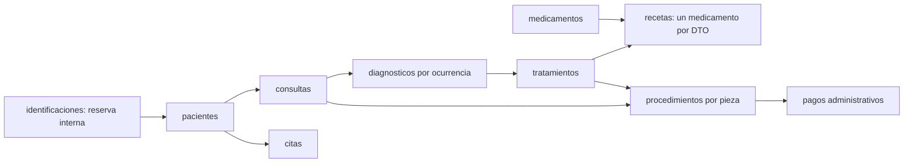

# Modelo A1 — odontología y contrato 1.0.0

Responsable Jennifer. Esquema documental y seed A1; no es la implementación del
puerto A3. Los contratos normativos son los del maestro 2.0, no los candidatos
históricos. El seed conserva las siete entradas antiguas sin transformarlas.

## Colecciones y relaciones

| Documento | Campos principales | Representación y razón |
|---|---|---|
| paciente | identificación, nombres/apellidos, nacimiento, estado, motivo/fecha archivo | Contacto pequeño embebido; historia separada para evitar crecimiento sin límite |
| cita | paciente/profesional, fecha_hora UTC, motivo, estado | Documento independiente; paciente puede acumular citas |
| consulta | paciente/profesional, cita opcional, fecha civil, notas_evolucion | Fecha explícita, diferente del instante de cita; historial ordenable por paciente/fecha |
| diagnóstico | paciente, consulta, codigo_cie10, descripción | Una ocurrencia clínica por documento; el código puede repetirse sin compartir identidad |
| tratamiento | paciente, diagnóstico de ocurrencia, indicaciones_generales | Referencia explícita, no se reconstruye parentesco por coincidencia de consulta |
| receta | paciente, tratamiento, medicamento, dosis/frecuencia/vía | Un renglón por DTO de API-09; sin arreglo creciente dentro de tratamiento |
| medicamento | nombre y presentación opcional | Catálogo referenciado; el fixture no tiene estado, por lo que todos sus elementos son habilitados según CAT-01 |
| procedimiento | paciente, consulta, tratamiento, pieza FDI, descripción/estado | Especialización separada; FDI permanente y temporal válidas, no altera DTO común |
| pago | paciente, procedimiento, fecha_hora, GTQ y centavos enteros | Registro administrativo de demo; sin cobro real ni pasarela |
| reserva identificación | identificación y paciente | Clave determinista SHA-256 de la identificación exacta; evita dos destinos lógicos en el seed |

Cada documento nuevo agrega `institucion: odontologica`, `schema_version: 2` y
`seed_version` internos. schema_version describe el modelo físico, no la versión
API (que sigue en 1.0.0). seed_version solo identifica la procedencia del fixture.
El contexto autenticado de A3/B1 determinará pertenencia; el fixture no autoriza
un principal ni permite elegir institución desde el cliente.

El modelo elige referencias para todos los conjuntos clínicos crecientes. Evita
duplicar la lista de diagnósticos en consulta y la de recetas en tratamiento.
Se repite `paciente_id` en descendientes como índice/validación de pertenencia;
esa referencia es inmutable y debe coincidir con toda la cadena de padres.
Contacto embebido es información pequeña que se lee con el paciente, con nota
acotada a 500 caracteres en el dataset. No se embeben historias completas.

## Tipos, límites y proyección

- IDs DEMO son cadenas estables de fixture; el formato no es una nueva restricción
  de IDs públicos de la API. No se exponen objetos DocumentReference ni Timestamp.
- Nombres/apellidos 1..100, identificación 1..20, notas/diagnóstico/tratamiento
  hasta 5000, CIE-10 hasta 20, dosis/frecuencia/vía hasta 100, motivo archivo 200.
  Textos obligatorios no vacíos; el fixture usa valores ya recortados.
- Nacimiento, fecha de consulta y fecha de archivo se guardan como cadena civil
  ISO `YYYY-MM-DD`. Se validan con calendario real y reloj America/Guatemala.
  Fecha futura inválida para nacimiento/consulta. No crear medianoche UTC.
- `fecha_hora` de citas/pagos es Timestamp Firestore a partir de datetime UTC.
  Los timestamps DEMO tienen milisegundos canónicos; no reemplazan fecha clínica.
- El caso de borde incluye una cita 2026-10-20T02:30Z (día 19 en Guatemala) y
  consulta explícita 2026-10-19. La fecha no se infiere automáticamente de la cita.
- Opcionales nulos de lectura: cita, vía, presentación y motivo/fecha archivo.
  El dataset es de almacenamiento/lectura; no confundir null con un DTO Create,
  cuyos opcionales de entrada se omiten según contrato.
- Activo exige metadatos de archivo nulos. Archivado conserva motivo/fecha y su
  cadena completa; inactivo heredado también es representable. Guardar una historia
  archivada en un seed no permite escrituras posteriores desde una API.
- Documentos pequeños y con textos acotados, sin arreglos crecientes. Límite físico
  Firestore: 1 MiB por documento; el diseño no usa ese límite como tamaño objetivo.
  El seed limita su transacción a 100 documentos; es un límite del seed, no de API.

`project_document` selecciona solo los campos de lectura normativos y agrega id;
omite paciente redundante donde el DTO no lo lleva, contexto, reservas y metadata.
`project_history` demuestra en datos validados el árbol ordenado por fecha/id y los
hijos por id. Son funciones puras de representación del fixture, no operaciones
del repositorio ni rutas activas. A3 materializará esa lectura sobre persistencia
con el runtime B1; no debe aplicar un validador exclusivo DEMO a pacientes reales.

Los dos pacientes tienen el mismo CIE-10 en diagnósticos distintos. Cada tratamiento
y receta se une a su ocurrencia; las pruebas impiden mezclar ramas o pacientes.

## Búsqueda e índices

Se preservan los textos originales. `busqueda` en paciente y `nombre_busqueda` en
medicamento almacenan trim + NFC + lower, conservando acentos, para prefijo literal
de §5.3. No son campos públicos y no hay regex ni comodines suministrados por UI.

Índices de campo simple sirven para buscar padres por consulta/diagnóstico/
tratamiento, identificaciones exactas y catálogo normalizado. El índice compuesto
`consultas(institucion ASC, schema_version ASC, paciente_id ASC, fecha ASC)` de firestore.indexes.json soporta la
consulta temporal por paciente; Firestore agrega el desempate de nombre documental.
firebase.json lo referencia y el Dockerfile copia ambos archivos. No se añaden
índices por cantidad: los nuevos patrones especializados se justificarán con su
consulta A3. El emulador **no** acredita la exigencia de índices en producción;
no se desplegó nada en Firebase real. El orden externo por IDs/identificación debe
mantenerse en A3 aunque difieran colaciones u orden físico.

## Seed seguro y coexistencia

clinical_demo.json tiene 18 documentos en nueve colecciones. `entries` deriva dos
reservas deterministas, total 20. El seed valida todo antes de escribir, lee todos
los destinos y consulta identificaciones existentes antes de crear el conjunto
en una sola transacción. Un documento diferente, reserva ocupada o paciente previo
sin reserva con la misma identificación aborta sin escrituras parciales.

Los escritores futuros deberán respetar la misma reserva para garantizar unicidad
concurrente; A1 no publica un servicio de altas ni afirma seguridad ante clientes
que ignoran el protocolo. A3 probará concurrencia, contexto y errores de dominio.
Los IDs/identificaciones v2 son distintos de v1: no se actualizan ni eliminan los
siete documentos originales. Coexisten 27, con reservas nuevas y metadata histórica
intacta. Cambios posteriores del dataset que colisionen deben revisarse; no hay
migración automática ni opción de forzar sobrescritura.

Los documentos v1 no se interpretan como historiales v2 ni se completan inventando
tratamientos/CIE-10 ausentes. A3 deberá seleccionar versión física soportada y
resolver cualquier dato histórico no clasificado mediante una migración explícita,
no por heurística ni filtrado silencioso de información real. En este repositorio
los siete registros v1 son exclusivamente el fixture sintético identificado.

## Recuperación y aceptación de A1

Exportar solo datasets DEMO exactos, incluyendo reservas. `--dataset both` exige
27 documentos; importar en otra instancia y verificar sin seed acredita la
persistencia de ambos modelos. Comandos/evidencia en README.md y VALIDACION.md.

A1 cubre esquema/modelado, validación, seed seguro, mapeo de campos, justificación
documental, almacenamiento y recuperación. No certifica autorización, API clínica,
los ocho métodos de A3 ni carreras entre archivo y escritura. Esas pruebas leerán
paciente dentro de la transacción y coordinarán dos clientes cuando exista B1.
No se pide otra ratificación de F0: el plan 2.0 lo sustituyó por estos módulos.
