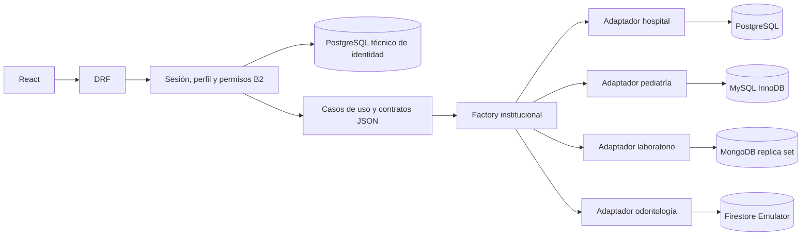
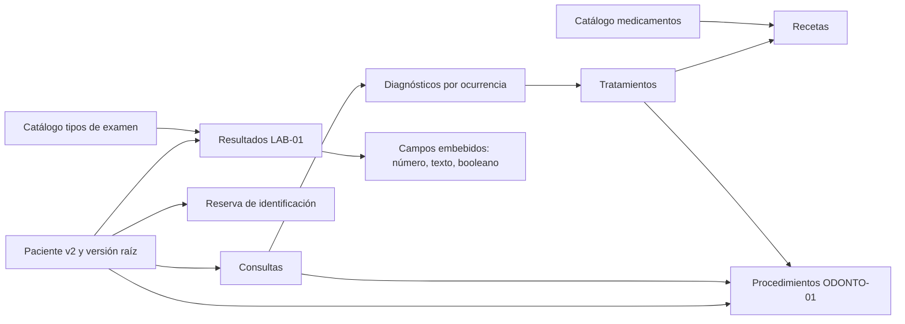

# A5 — análisis, modelos, comparación y trazabilidad final

Jennifer, 22 de octubre de 2026, America/Guatemala. Documento consolidado de la
célula A; incorpora evidencia publicada de B1–B5 sin modificar los documentos ni
atribuir nuevas pruebas a Pablo. Estado técnico de Jennifer: A1–A5 completos en
feature/jennifer. La validación del entorno compartido precede al merge, no se
confunde con terminar la documentación de A5.

## Qué puede hacer una persona

1. Inicia sesión. Su perfil decide institución y rol; no elige un motor desde la
   pantalla ni inicia una sesión Firebase/Mongo separada.
2. Busca un paciente existente por inicio de identificación/nombre/apellido, o
   registra uno nuevo. La identificación es única dentro de su institución.
3. Consulta el historial y registra atención, diagnóstico, tratamiento y receta
   con un medicamento del catálogo. El diagnóstico identifica una ocurrencia,
   aunque su código CIE-10 se repita en otra consulta.
4. Usa la especialización de su institución: hospitalización con cama/alta;
   tutor, vacuna y crecimiento pediátrico; resultados de laboratorio con campos
   variables; o procedimiento odontológico por pieza y tratamiento.
5. Admin archiva por motivo administrativo. El paciente y su historia permanecen
   legibles; no se admiten nuevas escrituras comunes ni especializadas.
6. Cierra sesión. El servidor invalida la sesión y el cliente cancela lecturas
   especializadas pendientes. No guarda tokens ni historia en localStorage.

Estos recorridos están comprobados con datos sintéticos persistidos. «Paciente
existente» incluye relectura de expedientes v2 y recuperación sin resembrar.
No se promete importar automáticamente historias antiguas de otro esquema.

## Arquitectura y asignación

La base de identidad no es una quinta institución. Django ORM gestiona identidad
y sesiones; los datos clínicos usan drivers nativos detrás de puertos. Los casos
de uso no importan drivers y las vistas no ejecutan consultas SQL. El contrato
común y SPECIALTY-API-01 determinan DTOs, permisos y errores; no los tipos del SDK.

| Institución | Motor y razón | Evidencia funcional y límite |
|---|---|---|
| Hospital | PostgreSQL: relaciones estrictas, FK/checks, exclusividad de cama y bloqueo raíz | B3 y HTTP A4/A5; ingreso/alta reales. No se acredita todo el modelo de facturación/cirugía. |
| Pediatría | MySQL InnoDB: seguimiento relacionado, tutores por vínculo y medidas con unidades explícitas | B4 y HTTP A4/A5; tutor/vacuna/control reales. No calcula calendario ni percentiles. |
| Laboratorio | MongoDB: cada resultado admite campos tipados diferentes; conjuntos crecientes referenciados | A3/LAB-01 y HTTP A4/A5; transacciones y recuperación nativa. Replica set de un nodo no aporta HA. |
| Odontología | Firestore: documentos y referencias por paciente/atención, procedimientos separados | A3/ODONTO-01 y HTTP A4/A5; recuperación nativa del emulador. No certifica cuotas, costos o reglas cloud. |

La asignación cumple cuatro instituciones/cuatro motores. No se usan SQLite,
Realm o LiteDB como motor institucional; el SQLite heredado no es el destino
clínico probado. No se midieron latencia, throughput ni costos comparativos.

## Modelo documental vigente y relaciones

| Concepto | Mongo clínico v2 | Firestore v2 | Decisión |
|---|---|---|---|
| Paciente, consultas, diagnósticos, tratamientos, recetas, medicamentos, reservas/citas | Colecciones `clinico_*` | Colecciones sin prefijo `clinico_` | IDs string y pertenencia institucional; historia creciente fuera del paciente |
| Resultado/examen | `clinico_resultados` y `clinico_tipos_examen` | No es la institución laboratorio | Un documento por resultado; 1..50 campos propios embebidos |
| Procedimiento | No es la institución odontológica | `procedimientos` | Referencias explícitas a paciente, consulta y tratamiento de la misma historia |

El modelo A2 legado conserva ObjectIds, fechas BSON y referencias de examen por
nombre en otras colecciones. No se confunde con LAB-01. A1 conserva sus documentos
v2 y ejemplos administrativos; pagos no forman parte del flujo obligatorio. El
contacto/tutor pequeño del modelo original justifica embebido cuando se lee con
su dueño; la nueva API común v2 no publica esos campos automáticamente.

Las referencias permiten crecimiento sin añadir toda la historia a un documento.
Los campos variables pertenecen al resultado y se leen juntos; no requieren una
columna SQL por modalidad. Duplicar paciente_id en hijos es desnormalización
controlada: la transacción valida la cadena y usa la raíz para competir con archivo.
El límite BSON de 16 MiB y límites del servicio siguen existiendo. Las pruebas de
crecimiento no constituyen un benchmark de escalabilidad.

## Comparación con el modelo relacional

Los diagramas y mapeos SQL están en [B3](../pablo/B3_POSTGRESQL.md) y
[B4](../pablo/B4_MYSQL.md); los DDL y restricciones son la evidencia implementada.
Nombres/nacimiento dependen del paciente; especialidad/colegiado del profesional;
nombre/presentación del medicamento; dosis/frecuencia de la prescripción. Separar
estas entidades evita copiar sus atributos en cada atención. Las aplicaciones
usan valores atómicos y entidades de relación en lugar de listas SQL en una celda.

En pediatría, diagnóstico de catálogo y ocurrencia consulta_diagnostico son distintos;
tratamiento referencia la ocurrencia. Paciente_tutor guarda parentesco por vínculo,
no como verdad global del tutor. Cabecera/detalle de receta conservan sus relaciones
y se escriben juntos. Las FK compuestas impiden mezclar consulta/paciente/tratamiento.
En hospital, diagnóstico tiene origen consulta o ingreso, sin inventar ambos.
Estas decisiones evitan dependencias parciales/transitivas evidentes en los
atributos del flujo; no se declara una demostración formal de 3FN de cada tabla
periférica ni una evaluación docente que no figura en los materiales.

| Aspecto | PostgreSQL / MySQL | MongoDB | Firestore |
|---|---|---|---|
| Relaciones | FK, checks y UNIQUE, más validación de aplicación | Referencias y unicidad/validadores; aplicación verifica padres | Referencias verificadas en aplicación; no FK SQL |
| Unidad atómica | Transacción nativa y bloqueo de paciente | Transacción multidocumento y cambio de versión raíz | Lectura de raíz/padres antes de escribir; cambio de raíz y reintentos |
| Archivo concurrente | Escritor/archivo compiten por fila raíz | Ambos escriben versión raíz; snapshot solo no basta | Reintento vuelve a comprobar activo |
| Fecha | DATE civil; timestamps hospitalarios UTC | Fechas civiles string e instantes UTC del contrato | Igual contrato, sin exponer Timestamp/DocumentReference |
| Recuperación verificada por A | Flujo HTTP con roles SQL limitados; recuperación SQL propia de B | Dump/restore frío, BSON/opciones/índices y continuidad | Export/import frío de emulador, tipos y continuidad |

No hay transacción distribuida entre instituciones. La equivalencia compara
operaciones/DTOs, no el mismo almacenamiento físico. La búsqueda/orden contractual
se normaliza antes de paginar; varias implementaciones leen todas las filas del
ámbito y no se presentan como optimizadas para grandes volúmenes.

## Clasificación y controles aplicados

| Clase | Datos | Control y tratamiento |
|---|---|---|
| Pública como referencia | Documentación, código de catálogo y datos DEMO identificados | No implica API anónima. Resolver catálogos utilizables exige sesión y permiso. |
| Confidencial | Identificación, nombre, nacimiento, contacto y tutores | Institución del principal, autorización por operación, no-store y errores seguros. IDs opacos no anonimizan. |
| Restringida clínica | Evolución, diagnóstico, receta, resultados, mediciones, procedimientos y motivo/fecha de archivo | Roles/vínculo profesional, relaciones y transacciones. Archivo conserva lectura y rechaza escritura. |
| Restringida de seguridad | Password/hash, cookies/CSRF, credenciales, perfiles técnicos y respaldos completos | HttpOnly/CSRF/rotación/logout; sin tokens en localStorage; secretos fuera de Git; respaldo privado y restore aislado. |

Secretaría pediátrica recibe tutores, sin historia ni seguimiento; enfermería lee
sin escribir; laboratorista registra resultados de su institución sin prescribir.
Un superusuario técnico no salta el perfil clínico. Los roles SQL runtime no son
propietarios y no pueden hacer DDL/borrado ni leer usuarios clínicos heredados.

Mongo local sin auth y Firestore Emulator permiten acceso directo a quien llegue
a esos servicios; se probaron destinos de loopback, no autorización cloud ni TLS.
Los backups heredan la mayor sensibilidad de su contenido. Hash verifica alteración
accidental, no autenticidad frente a quien sustituya también el manifiesto.

## Trazabilidad REQ-01..13

| Requisito del maestro | Evidencia disponible en esta rama | Límite o pendiente de integración |
|---|---|---|
| 01 cuatro instituciones/motores | Asignación anterior; A4 HTTP en cuatro motores | Entorno compartido por verificar |
| 02 hexagonal y cliente-servidor | Puertos/casos de uso/factory y siete recorridos HTTP A4 | No es un despliegue público |
| 03 modelo relacional/normalización | B3/B4, DDL y diagramas; análisis de dependencias anterior | Sin feedback/diagrama externo de Entrega I acreditado |
| 04 modelos documentales y justificación | A1/A2, modelos v2, embebido/referencia y LAB/ODONTO | Históricos ajenos al esquema requieren inventario |
| 05 consultas equivalentes | Contrato común, suite NoSQL 49 y flujo HTTP/nativo en cuatro motores | No transacción distribuida ni benchmark |
| 06 nuevos pacientes/historiales | Alta, lectura nueva conexión, duplicado institucional y aislamiento | Solo fixtures sintéticos en pruebas |
| 07 consulta/diagnóstico/tratamiento/receta | Cadena A4 y verificaciones A5 reales | Profesional habilitado y catálogo requerido |
| 08 archivo administrativo | Historia conservada, idempotencia, 409 posterior y carreras nativas | No borrado físico |
| 09 identidad/enrutamiento | B2 + UI/API, CSRF/roles/logout, sin selector de motor | Preparar identidad compartida de forma explícita |
| 10 interfaz ordenada/uniforme | Componentes comunes/especializados, estados y permisos; A4 cerrado | Catálogos reales del entorno deben existir |
| 11 comparativo modelado/consistencia/seguridad | Este documento y COMPARATIVO_Y_CLASIFICACION_A.md | Distingue evidencia A y B, sin métricas inventadas |
| 12 pública/confidencial/restringida | Matriz anterior y controles verificados por HTTP | No certifica cifrado ni reglas Firebase productivas |
| 13 análisis existente/nuevo y operaciones sencillas | Escenarios, entidades, relaciones y recuperaciones sin seed | No atribuye revisión de Entrega I inexistente |

El PDF original no está versionado; el maestro registra su lectura y checksum.
No se aportaron observaciones docentes externas nuevas. Su ausencia se registra,
sin fabricar comentarios ni afirmar que fueron incorporados. Esta trazabilidad
consolida el aporte técnico A5; no sustituye la revisión académica del profesor.

Evidencia, SHAs, comandos y límites: [cierre A4](A4_CIERRE_REAL.md),
[integración común](A5_INTEGRACION_REAL.md), [recuperación](A5_RECUPERACION_NOSQL.md),
[cierre A5](A5_CIERRE.md), [paso a entorno común](PASO_A_ENTORNO_COMUN.md).
