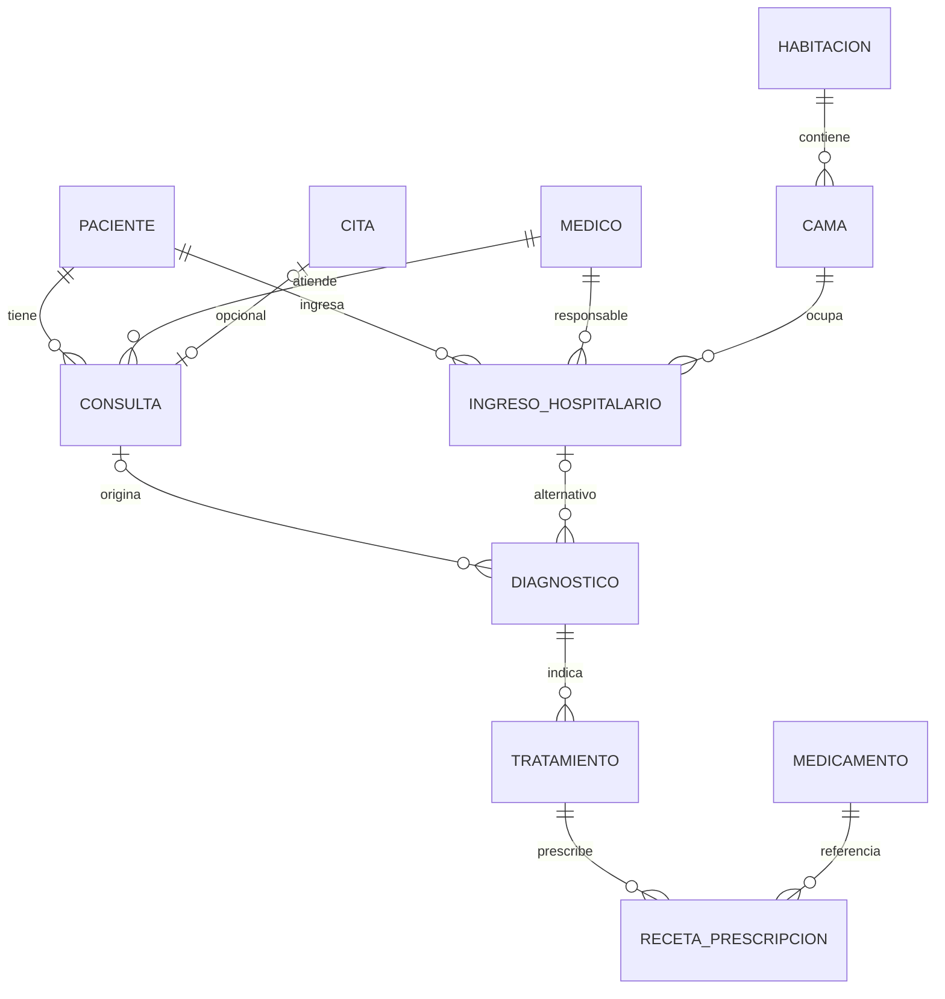

# B3 — Persistencia hospitalaria PostgreSQL

Responsable: Pablo. Fecha local: 2026-10-21. Rama: `feature/pablo`.
Base: B2 integrado por PR #13, `53a04d4`.
CONTRACT-API-01 y CONTRACT-REPO-01 permanecen en **1.0.0**.
Extensión aditiva publicada: **CONTRACT-HOSPITAL-01@1.0.0**, sin rutas HTTP nuevas.

## Implementación y alcance

`PostgreSQLAdapter` conserva salud sin contexto e implementa los ocho métodos
clínicos y `MedicamentoCatalogo`. La factory B1 construye el proveedor real al
recibir un `ContextoClinico` hospitalario. Rechaza otra institución antes de abrir
conexión; sin contexto solo permite salud. No recibe motor, base, médico o usuario
desde el cuerpo clínico. Usa psycopg parametrizado, conexiones cerradas y transacciones
nativas; no hay ORM clínico, SQL en vistas ni transaction.atomic sobre estos datos.

Las operaciones vuelven a validar DTO y permisos para proteger también el uso directo
del puerto. El médico de consulta proviene de profesional_id del principal B2, como
string del id_medico real; debe existir y estar habilitado. No se busca el primer
médico disponible ni se sustituye una referencia DEMO sin resolver.

| Concepto externo | Tabla / columnas PostgreSQL |
|---|---|
| Paciente / identificación | paciente / id_paciente, dpi_cui |
| Archivo | paciente / estado, motivo_baja, fecha_baja |
| Consulta / cita opcional | consulta / fecha DATE, id_paciente, id_medico, id_cita |
| Diagnóstico de ocurrencia | diagnostico / id_diagnostico, id_consulta |
| Tratamiento | tratamiento / id_diagnostico |
| Receta | receta_prescripcion / id_tratamiento, id_medicamento |
| Catálogo | medicamento / nombre_comercial, presentacion |

Los IDs públicos son strings opacos tipados: H-P-, H-C-, H-D-, H-T-, H-R-, H-M-,
H-CITA-, H-CAMA- e H-I- seguidos por la PK SERIAL positiva. Los clientes deben
reutilizar los IDs devueltos completos. No aceptar IDs numéricos ni de otra entidad
evita confundir una receta con un paciente que tenga la misma PK. Una referencia
ausente, extranjera o de otro tipo produce el mismo RecursoNoEncontrado.

El historial devuelve consultas/diagnósticos/tratamientos/recetas anidados con arrays
vacíos, fechas civiles e IDs string. Se ordenan consultas por fecha e id string;
hijos por id string, incluyendo H-D-10 antes de H-D-2. Los diagnósticos originados en
ingreso, ya presentes en el modelo hospitalario, conservan sus FKs y datos; el árbol
común de contrato representa la rama de consultas. No se eliminó otra rama del modelo.

La búsqueda aplica exactamente trim/NFC/lower y prefijo literal a identificación,
nombres y apellidos; catálogo a nombre. Se normaliza y ordena en Python sobre filas
de la institución, evitando divergencias de Unicode/collation entre SQL y el contrato.
No se interpola el texto en SQL ni se ejecutan regex/LIKE; `%`, `_` y `[` son
literales. Count precede a paginación. Esta implementación lee las filas completas
para asegurar semántica uniforme; no pretende optimización para grandes volúmenes.
El catálogo no tiene columna estado: todos sus registros se consideran habilitados,
independientemente del stock. Prescribir no equivale a despachar inventario.

## Modelado e integridad



Identificación y colegiado son claves candidatas únicas. Atributos demográficos
dependen del paciente, datos profesionales del médico, medicamento del catálogo y
dosis/frecuencia de la prescripción. No se copian esos datos entre entidades. Cada
diagnóstico clínico es una ocurrencia, incluso al repetir CIE-10 en consultas distintas;
el tratamiento referencia esa ocurrencia. Las relaciones se preservan por FK.
El check de origen de diagnóstico exige exactamente consulta o ingreso, nunca ambos.

La cita tiene UNIQUE(id_cita,id_paciente,id_medico) y la consulta referencia esa
tupla además de sus FKs originales. Así, el almacenamiento también rechaza una
cita de otro paciente/profesional. id_cita sigue siendo nullable y UNIQUE; se pueden
registrar varias consultas sin cita. La fecha civil de consulta es independiente
de la fecha/hora de cita. No se la deduce de esta última.

Se agregan checks de textos clínicos requeridos y coherencia de motivo/fecha al
archivar. Los índices de relación apoyan lectura del árbol. Dos índices únicos
parciales impiden dos ingresos activos en una cama o para un paciente. El resto del
modelo —cirugía, enfermería, movimientos, facturación y usuario heredado— se conserva.
La autenticación sigue siendo solo Django/B2; hospital_runtime no puede leer usuario.

## Transacciones, archivo y errores

Cada escritura completa se confirma o revierte en una transacción. Consulta,
diagnóstico, tratamiento, receta, ingreso, alta y archivo bloquean al paciente raíz
con FOR UPDATE y revalidan estado/relaciones después de obtener el bloqueo. No hay
escrituras clínicas nuevas para inactivo/archivado. El médico se comprueba dentro de
la operación; sus datos, medicamentos y camas no reciben privilegios de edición
para poder consultarlos. Sus FKs y el índice de ocupación protegen las referencias.

Cita opcional se bloquea y comprueba contra paciente, profesional, estado programada
y consumo previo. Su transición a atendida y el alta de consulta son indivisibles.
Los fallos inyectados tras una mutación SQL prueban rollback, incluido consumo de cita.

Archivo conserva toda la historia y usa fecha civil America/Guatemala desde Python.
Mismo motivo repetido devuelve el mismo resultado sin cambiar fecha; motivo distinto
produce 409. La extensión hospitalaria exige cerrar un ingreso activo antes de
archivar (409 mientras exista), para no dejar una cama ocupada sin posibilidad de alta.
Esta condición hospitalaria se publica aquí y debe reflejarla la UI al integrar B5.

Si escribe primero, su commit queda en la historia antes del archivo; si archiva
primero, el escritor espera y luego obtiene Conflicto. Se prueba con eventos, dos
conexiones y observación real de pg_blocking_pids; no se infiere a partir de sleeps.
Lecturas de página e historial usan transacción REPEATABLE READ READ ONLY para que
consultas sucesivas de un árbol no mezclen commits. No se promete snapshot entre
dos solicitudes distintas de paginación.

UniqueViolation se traduce a Conflicto; FK a RecursoNoEncontrado; datos/check/null
inválidos a DatosInvalidos; otros errores psycopg, timeout y deadlock a
PersistenciaNoDisponible. No se devuelven SQL, trazas, conexiones ni credenciales.
No hay reintentos automáticos de POST. Statement timeout 15s y lock timeout 5s.

## CONTRACT-HOSPITAL-01@1.0.0

Puerto auxiliar `HospitalizacionRepository`, DTOs en domain/hospital.py:

| Método | Entrada y resultado |
|---|---|
| ingresar_paciente(paciente_id, ingreso) | ingreso={cama_id,fecha_hora_ingreso,tipo_ingreso}; devuelve IngresoRead |
| listar_ingresos(paciente_id) | {paciente_id,ingresos:[IngresoRead]} sin truncado |
| dar_alta(ingreso_id, fecha_hora_alta) | IngresoRead con alta confirmada |

IngresoRead agrega id, paciente_id y fecha_hora_alta nullable. Timestamps UTC ISO-8601
con Z, válidos y no futuros; tipo_ingreso string 1..50. Ingresar/alta aplican permisos
de atención (admin/medico con profesional); leer usa permisos de historial.
Solo pacientes activos admiten mutación. Alta anterior al ingreso es inválida;
repetir la misma alta mientras el paciente siga activo es idempotente, otra fecha
es conflicto. La cama puede reutilizarse tras el alta. Se conservan todos los ingresos.
No hay rutas HTTP inventadas: B5 debe publicar cualquier extensión HTTP antes de
consumirla desde A4, manteniendo v1 común. No es un noveno método de HistorialRepository.

Nuevos ingreso_utc/alta_utc TIMESTAMPTZ son los timestamps autoritativos. Las columnas
TIMESTAMP originales se conservan para no reinterpretar ni borrar historia; nuevas
escrituras reflejan el valor UTC en ellas. Fechas antiguas requieren confirmación
de su zona/instante antes de completar las columnas nuevas; no se asume que fueran UTC.

## Configuración, inventario y migración

Generar HOSPITAL_APP_PASSWORD diferente de las claves existentes y guardarla solo
en .env. PG_USER/PG_PASSWORD siguen siendo el propietario local para mantenimiento;
el backend recibe PG_USER=hospital_runtime y solo HOSPITAL_APP_PASSWORD como su clave.
No se cambian los usuarios de MySQL, MongoDB, Firestore ni identidad.

```powershell
docker compose run --rm hospital-migrate
```

Por defecto **solo inventaría** cantidades y pendientes. Para migrar después de
revisar inventario y ensayo, detener escrituras del backend:

```powershell
docker compose stop backend
docker compose run --rm hospital-migrate bash /schema/migrate.sh all
docker compose up --build -d --no-deps backend
```

Cada fase que modifica crea primero un directorio privado nuevo en
`.local/postgres-backups/`, ejecuta pg_dump custom y valida el archivo con
pg_restore --list. No se imprimen secretos ni datos de pacientes. Los respaldos se
conservan fuera de Git. Nunca usar down -v ni recrear el volumen como actualización.

Las fases independientes son expand, finalize y roles. La expansión agrega
consulta.fecha nullable, medico.habilitado y timestamps UTC nullable. No altera
datos históricos. La finalización exige fechas/timestamps confirmados, valida
textos/archivo/parentescos y crea constraints/índices en una sola transacción.
Si falla, no confirma DDL parcial de finalización; la expansión anterior se conserva.
Reconciliar cada dato desconocido con evidencia propia antes de volver a finalizar.
No rellenar con CURRENT_DATE, la fecha de cita ni un diagnóstico elegido arbitrariamente.

roles crea/configura hospital_runtime sin superuser/createdb/createrole, concede
SELECT y el INSERT/UPDATE necesario, uso de secuencias, sin DELETE, CREATE ni acceso
a usuario. Solo mantenimiento recibe la clave del propietario. Reaplicar roles es
una operación explícita; una clave cambiada en .env no rota sola la del servidor.
init.sql contiene el esquema nuevo para volúmenes vacíos; en existentes se usan las
migraciones incrementales. hospital_schema_version registra B3-1.0.0 al finalizar.
El flag operativo medico.habilitado arranca true, coherente con el registro previo
sin estado; no constituye una verificación externa de licencia médica.
El experimento C0 verificar_diseno.sql conserva su DDL histórico; para repetirlo
usar fixtures/postgres_legacy.sql como base, no el init.sql B3 que ya contiene fecha.

Reversión: con el backend detenido, conservar la base actual y restaurar el dump
previo en una base separada. Verificar esquema, cantidades y relaciones antes de
cambiar conexiones o nombres; no sobrescribir la base actual para probar el backup.
Usar el backend B2 correspondiente al esquema previo. Si ya hubo nuevas escrituras,
reconciliarlas antes del cambio para no descartarlas. El ensayo automatizado usa
pg_dump/pg_restore reales y confirma recuperación de la consulta y del esquema sin
fecha previo a B3. No elimina ni modifica el hospital activo para probar reversión.

## Pruebas reproducibles

Crear test_b3_hospital **solo si no existe**, desde el propietario del servidor
hospitalario. Mantener test_b2_identidad precreada según B2. El runtime no recibe
CREATEDB para ejecutar pruebas.

```powershell
docker compose exec -T postgres sh -c 'createdb -U "$POSTGRES_USER" test_b3_hospital'
docker compose build hospital-tests
docker compose run --rm hospital-tests
docker compose run --rm -e PGDATABASE=test_b3_hospital hospital-migrate bash /schema/tests/rehearsal.sh
```

El harness exige HOSPITAL_TEST_DB=test_b3_hospital y crea schemas/roles aleatorios
exclusivos. Cada operación clínica usa un rol sin superuser/createdb/createrole con
los grants reales de runtime_role.sql. El propietario solo prepara fixtures y limpia
ese schema/rol exactos; no hay limpieza global ni caída de volúmenes. Conexiones de
operaciones y carreras son independientes. Los hooks son subclases de pruebas, no
flags configurables desde HTTP. El ensayo restore crea dos bases test_b3_restore_*
únicas y retira solo las que él mismo creó, conservando los dumps de evidencia.

Se reutiliza RepositoryContract para cadena clínica, orden, prefijo literal,
catálogo, archivo/rollback y carreras. Dos casos institucionales se especializan:
este proveedor solo acepta hospital; se comprueba rechazo de contexto ajeno y de
IDs extranjeros/ausentes en PostgreSQL real. No se sustituye MySQL por un doble ni
se anuncia cobertura de los cuatro repositorios; B4/A3/B5 completarán esa integración.
Se corrigió un fixture de prueba de archivo para enviar receta completa y comprobar
estado archivado con datos válidos, conservando la conducta del doble B1.

Evidencia final: **120 pruebas combinadas B1/B2/B3 aprobadas, sin omisiones**, PostgreSQL
16, Python 3.13 y Django 5.2.18 en Docker. Incluye cuentas/permisos B2, traslados de
identidad, suite real hospitalaria, roles runtime, cita/FK compuesta, archivo civil,
rollback, dos órdenes archivo/escritura, bloqueo confirmado en servidor, snapshot
coherente y carrera por cama. No se modificaron archivos A.

Comprobaciones adicionales aprobadas: 8 tests de contrato cliente, Compose config -q,
check Django contra identidad, build Vite con salida /tmp/rim-b3-dist y los dos
endpoints de salud HTTP 200 con cuatro connected=true. El build no dejó archivos
nuevos en frontend. Diff sin errores; claves y backups ignorados. El SHA de código
y los comandos/resultados finales se registran en el PR del módulo.

Aplicación local: inventario de paciente/consulta/medico/ingreso/cama/cita/medicamento
era cero. Se ensayó restore, se respaldó y se ejecutó all con backend detenido;
reiniciado con hospital_runtime. La factory y lecturas de pacientes/catálogo se
verificaron con ese rol. No se agregaron pacientes ni médicos DEMO al hospital activo.
Dump de corte local: `.local/postgres-backups/20261022T010407Z-all-1/hospital.dump`
(nombre UTC de la herramienta; fecha civil de esta entrega 2026-10-21).

Datos de pacientes e historia son confidenciales; contraseñas/respaldos/identidades
técnicas son restringidos; catálogos de medicamentos no contienen historia personal.
Este aporte de modelado, consistencia y permisos alimenta el comparativo B5. La
API clínica común y su integración con UI siguen siendo B5/A4; B3 entrega persistencia.

Referencias: [bloqueos PostgreSQL 16](https://www.postgresql.org/docs/16/explicit-locking.html),
[constraints PostgreSQL](https://www.postgresql.org/docs/16/ddl-constraints.html),
[transacciones psycopg](https://www.psycopg.org/psycopg3/docs/basic/transactions.html).
