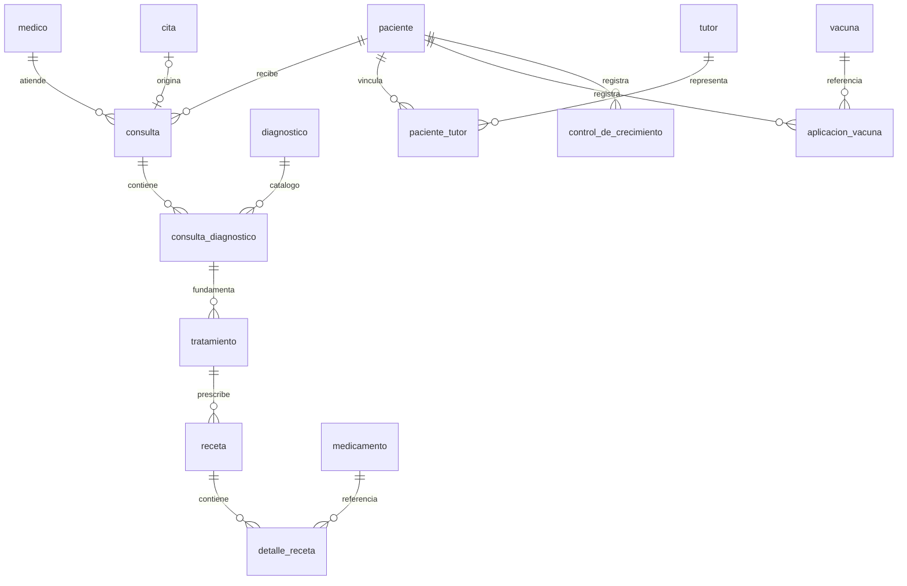

# B4 — persistencia pediátrica MySQL

Responsable: Pablo, rama permanente `feature/pablo`. Base integrada B3:
`417d8922613535b7c502983f658590481b5d7d7b` (PR #14).
Ejecución local: 2026-10-21, Guatemala. El nombre UTC del respaldo puede indicar
2026-10-22. Este módulo conserva CONTRACT-REPO-01@1.0.0 y CAT-01; publica
PED-01@1.0.0 como puerto auxiliar. La API clínica HTTP corresponde a B5.

## Comportamiento y modelo

`MySQLAdapter` implementa las ocho operaciones, el catálogo de medicamentos y
`PediatriaRepository`. Usa Connector/Python e InnoDB, sin ORM clínico ni
`transaction.atomic`. La factory selecciona el proveedor mediante el contexto
autenticado B2. Únicamente acepta institución `pediatrico`; profesional y rol
proceden del principal. No acepta identidad, institución o médico en los DTOs.
`health_check` sigue disponible sin contexto y solo verifica conectividad;
las operaciones clínicas exigen la versión de esquema completada.

Las 35 tablas originales permanecen; se añaden dos tablas técnicas de
conciliación/versionado. Exámenes, seguros y facturación conservan sus datos y
relaciones, pero este módulo no publica sus CRUD. No se afirma haber incorporado
feedback docente o diagramas externos ausentes del repositorio.

| Contrato | Persistencia / identidad externa |
|---|---|
| Paciente | `paciente`, nombre → nombres; `PED-P-{id}` |
| Consulta | `consulta`, observaciones → notas_evolucion; `PED-C-{id}` |
| Diagnóstico | ocurrencia `consulta_diagnostico.id`, código/descripción del catálogo; `PED-D-{id}` |
| Tratamiento | `tratamiento.consulta_diagnostico_id`, indicaciones; `PED-T-{id}` |
| Receta | renglón `detalle_receta.id`; padre desde cabecera `receta.tratamiento_id`; `PED-R-{id}` |
| Medicamento / cita | `PED-M-{id}` / `PED-CITA-{id}` |
| Tutor vinculado | `paciente_tutor.id` → `PED-PT-{id}`, `tutor.id` → `PED-TUTOR-{id}` |
| Vacuna / aplicación / control | `PED-V-{id}` / `PED-AV-{id}` / `PED-G-{id}` |

Los consumidores tratan todos los IDs como strings opacos; nunca los construyen.
Se rechazan ceros iniciales, desbordes, IDs de otro tipo o institución con 404;
IDs vacíos/no string son 400. Las FKs usan INT internamente.

La separación catálogo/ocurrencia permite reutilizar un diagnóstico sin mezclar
sus ramas. Se reutiliza solo código+descripción exactamente iguales, sin editar
catálogo histórico; una redacción distinta crea otra fila. No se impone UNIQUE
`(consulta_id,diagnostico_id)`: el contrato permite ocurrencias repetidas, incluida
la prueba compartida de orden. Esa UNIQUE fue una propuesta C0, sustituida por
el contrato actual; no se deduplican registros históricos. Sí existe UNIQUE
`(consulta_id,id)` como destino de la FK compuesta del tratamiento. Receta también
comprueba `(consulta_id,tratamiento_id)`. La redundancia de consulta se protege
mediante FKs, evitando dependencias contradictorias.

Consulta permite varias `cita_id=NULL`, conserva FK/UNIQUE de cita y añade FK
compuesta paciente/médico/cita. La cita debe estar programada y corresponder a
ambos; pasa a atendida dentro de la misma transacción. Su fecha no reemplaza la
fecha recibida de consulta. La cabecera de receta usa el día de prescripción en
Guatemala, nunca la fecha de consulta. Cada alta crea cabecera y detalle juntos;
cabeceras históricas con varios detalles producen varios DTOs.

`tratamiento.nombre` pasa a nullable porque el DTO solo proporciona indicaciones;
se conserva el nombre histórico y no se inventa uno para nuevos tratamientos.
Identificación mantiene VARCHAR(100) para conservar datos anteriores, con
`utf8mb4_0900_bin` para unicidad exacta como PostgreSQL; altas contractuales siguen
limitadas a 20 caracteres. No se interpreta la identificación como un número.

## Transacciones, lectura y errores

Cada escritura resuelve el paciente raíz y toma `SELECT ... FOR UPDATE` antes
de comprobar activo; revalida el padre y confirma/revierte toda la operación.
Archivo usa el mismo bloqueo. Igual motivo conserva fecha/historia; otro motivo
genera 409. Inactivo/archivado rechaza nuevas consultas, diagnósticos, tratamientos,
recetas y especializaciones. No hay borrado físico ni reintentos ciegos de POST.
Profesional debe existir y tener estado activo; no se usan credenciales de la
tabla `usuario`, porque B2 es la fuente única de identidad.

Escrituras usan READ COMMITTED para revalidar después del bloqueo con datos
confirmados recientes. Historial y seguimiento usan REPEATABLE READ, READ ONLY,
WITH CONSISTENT SNAPSHOT para una lectura coherente sin bloquear al escritor.
La fecha civil permanece DATE; sesiones nativas usan UTC para tiempos internos.
Timeout de espera de bloqueo: 5 segundos. Conexiones y cursores se cierran.

SQL está parametrizado. Duplicado 1062 → 409; FK 1451/1452 → 404; datos/checks →
400; desconexiones, SQL inesperado, deadlocks y timeouts → 503 genérico. Errores
de dominio conservan su código, sin mostrar SQL, credenciales o excepciones del
driver. No se devuelve éxito con persistencia ausente o migración incompleta.

La búsqueda conserva exactamente NFC/trim/lower y prefijo literal, incluidos
acentos, `%`, `_` y comillas. Se filtra/ordena antes de count y paginación; pacientes
por identificación e ID string; catálogo por nombre normalizado e ID. Solo se
ofrecen medicamentos activos. Historial completo se ordena por fecha/ID y ramas
por ID string, sin truncar ni mezclar diagnósticos. La normalización se realiza
en Python sobre filas institucionales para coincidir con PostgreSQL; no se
promete rendimiento de búsqueda para grandes volúmenes. Un índice/proyección
futuro debe pasar la misma suite antes de sustituir esta implementación.

## PED-01@1.0.0

Puerto auxiliar en `domain/pediatria.py`; sin nuevas rutas HTTP en B4.

| Método / entrada | Salida y reglas |
|---|---|
| `registrar_tutor(paciente_id,{nombres,apellidos,parentesco,telefono?,correo?,dpi?})` | vínculo y tutor con IDs distintos, datos y paciente_id; opcionales ausentes → null |
| `registrar_vacuna(paciente_id,{vacuna_id,fecha,dosis,lote?,observaciones?})` | aplicación con ID, mismos campos y paciente_id; dosis entero positivo, fecha civil no futura y vacuna existente |
| `registrar_crecimiento(paciente_id,{fecha,peso_kg,talla_cm,observaciones?})` | control con ID, fecha, paciente_id y medidas decimales string con dos decimales |
| `obtener_seguimiento(paciente_id)` | `{paciente_id,tutores:[],vacunas:[],crecimiento:[]}`; sin paginación/truncamiento |
| `listar_vacunas(q="",limit=20,offset=0)` | página `{count,limit,offset,results:[{id,nombre}]}`; prefijo/orden normalizados |

Tutores: admin/médico/secretaria, mismos permisos que alta de paciente. Vacunación
y crecimiento: admin/médico con profesional habilitado, mismos permisos que
consulta. Seguimiento y catálogo de vacunas: admin/médico/enfermero, mismos permisos
que historial pediátrico. Secretaría no recibe historial ni seguimiento clínico.
Se rechazan campos desconocidos, null explícito en opcionales y suplantación del
profesional. Texto: 100 caracteres salvo correo 150 y observaciones 5000.

El parentesco nuevo depende del vínculo paciente–tutor, no globalmente de tutor.
No se fusionan personas por nombre/DPI; cada alta crea tutor y vínculo atómicos.
Al leer vínculos antiguos sin parentesco confirmado, se mantiene null y se muestra
`parentesco_legacy` separado, sin asumir que el atributo global era válido para
cada menor. No se publica reutilización/búsqueda transversal de tutores.

Mediciones nuevas exigen strings decimales positivos, máximo 9999.99 (capacidad
DECIMAL(6,2)), máximo dos decimales; se rechazan floats, NaN, exponentes y bool.
Son límites de almacenamiento, no rangos clínicos recomendados. Nuevas columnas
`peso_kg/talla_cm` hacen explícitas las unidades. Campos originales peso/talla/
altura/percentil se conservan y se devuelven como `mediciones_legacy` separadas;
no se les atribuyen unidades históricas ni se calculan percentiles. Nuevas medidas
dejan esos campos sin completar. Las aplicaciones y controles nuevos registran
al profesional en columna interna; históricos desconocidos conservan null.
No se prescribe calendario, dosis clínica ni evaluación pediátrica automática.

## Actualización de volúmenes y reversión

1. Usar una ventana sin escritores (detener backend y clientes SQL externos).
   Completar `.env` con PEDIATRIA_APP_PASSWORD distinta de otras claves. Conservar
   MYSQL_USER/MYSQL_PASSWORD para administración heredada; backend usa únicamente
   `pediatria_runtime` y la clave nueva, nunca root ni el usuario propietario.
2. `docker compose run --rm pediatria-migrate` solo inventaría cantidades.
3. `docker compose run --rm pediatria-migrate bash /schema/migrate.sh expand`.
   Antes de modificar: mysqldump consistente, privado, hash SHA-256, restauración
   real en `test_b4_restore_<timestamp>_<sufijo_aleatorio>` y comparación de checksums de todas
   las tablas. Ante cualquier fallo se detiene antes de la migración. No repara
   ni borra datos para lograr una comparación. Los respaldos quedan en
   `.local/mysql-backups/`, ignorada por Git. Contienen información restringida.
4. Expansión agrega vínculos nullable y columnas especializadas, preserva legado.
   Revisar fichas originales y registrar en `pediatria_conciliacion` únicamente
   vínculos confirmados: tipo tratamiento/receta, ID histórico, origen_id y
   evidencia no vacía. No elegir el primer candidato aunque parezca probable.
5. `... bash /schema/migrate.sh reconcile` valida todas las asociaciones y las
   aplica en una transacción DML. Rechaza padres cruzados, ausentes o cambio de
   una asociación ya confirmada; revierte todo si falla. Datos históricos con
   texto clínico desconocido requieren conciliación documentada, nunca relleno
   ficticio para habilitar el adaptador.
6. `... bash /schema/migrate.sh finalize` ejecuta el preflight completo antes de
   los ALTER: vínculos existentes, texto clínico requerido, cita compatible,
   medidas nuevas y profesionales referenciados. Pendientes bloquean el cierre.
   Después impone NOT NULL/FKs/índices/check y registra versión 1.
7. `... bash /schema/migrate.sh roles` configura/restringe runtime. `all` realiza
   expansión, conciliación, cierre y roles; apropiado para bases vacías o ya
   conciliadas. Cada invocación mutante vuelve a respaldar/restaurar primero.
8. `docker compose up -d --no-deps backend`, verificar check y cuatro conexiones.

Runtime tiene SELECT/INSERT en tablas operativas, UPDATE solo paciente/consulta/
cita y SELECT en catálogos/profesional/versionado. No DELETE, DDL, GRANT OPTION,
acceso a `usuario` ni escritura de catálogos. Credenciales root solo llegan al
servicio temporal de mantenimiento/pruebas. SQL clínico nunca usa root.

MySQL hace commits implícitos con ALTER: una falla de DDL puede dejar pasos ya
confirmados. Los scripts son reiniciables por catálogo; no prometen rollback de
esquema. Si hay pendientes, conservar expansión, conciliar y volver a cerrar.
La versión se escribe al final; un esquema a medio migrar no sirve operaciones.
Una intervención manual tras una activación existente exige volver a detener
escritores; la marca no sustituye un control administrativo de mantenimiento.

Para reversión completa: detener escritores, respaldar también el estado actual,
restaurar el dump anterior en **otro destino limpio**, comprobar checksums y
relaciones, y solo después planificar el cambio al destino recuperado con su
versión compatible de aplicación/credenciales. No importar ciegamente un dump
antiguo sobre el volumen que recibió escrituras nuevas; perdería esas escrituras.
El ensayo automático demuestra recuperación de la copia previa, no la conciliación
de cambios posteriores. No usar `down -v`, DROP sobre pediatrico ni borrar volumen.

`init.sql` contiene el esquema final para nuevas instalaciones; no actualiza
volúmenes existentes. La copia anterior está en `fixtures/mysql_legacy.sql`;
`verificar_diseno.sql` conserva su carácter experimental C0 y usa esa copia.

Referencias técnicas: [transacciones Connector/Python](https://dev.mysql.com/doc/connector-python/en/connector-python-api-mysqlconnection-start-transaction.html),
[commits implícitos](https://dev.mysql.com/doc/refman/8.4/en/implicit-commit.html),
[FKs MySQL 8.4](https://dev.mysql.com/doc/refman/8.4/en/create-table-foreign-keys.html).

## Evidencia reproducible y límites

`docker compose run --rm pediatria-tests` ejecuta B1–B4 e identidad en motores
reales. Requiere identidad de prueba `test_b2_identidad` y base hospitalaria
`test_b3_hospital` preparadas según B2/B3. MySQL genera una base
`test_b4_<uuid>` y usuario `b4r_<uuid>` por prueba; el código verifica exactamente
esos nombres antes de limpiar. Cada operación usa los grants reales del archivo
runtime, adaptados al usuario/base aislados. El administrador solo prepara y
verifica fixtures sintéticos. No se insertan fixtures en pediatrico.

La suite incluye contrato compartido, errores/validación/contexto, fechas,
catálogo activo, identificación concurrente, ocurrencias compartiendo catálogo,
varios detalles por receta, FKs cruzadas, citas compatibles y sin cita, rollback
de cabecera/detalle y de todas las operaciones, archivo/idempotencia, especialidades,
permisos SQL reales y comparación estructural entre init nuevo y migración antigua.
Dos conexiones más `performance_schema.data_lock_waits` prueban ambos órdenes
archivo/escritura y escritor revertido; una prueba de snapshot escribe concurrentemente
y comprueba que la lectura no mezcla commits. Hay aislamiento real PostgreSQL↔MySQL
con igual identificación y rechazo de todos los padres cruzados.

La actualización local restauró/comparó el respaldo antes de aplicar B4. Respaldo
verificado: `.local/mysql-backups/20261022T013614Z-all-1/pediatria.sql`.
Repetición idempotente con restauración comparada de las 37 tablas del esquema
final: `.local/mysql-backups/20261022T014006Z-all-1/pediatria.sql`, también aprobada.
Inventario antes/después: 0 registros en las diez tablas clínicas inventariadas;
no se trasladaron cuentas ni se generaron pacientes locales. Una primera ejecución
se detuvo antes de ALTER porque la imagen no traía `cmp`; el script usa los
SHA-256 disponibles y la ejecución completa posterior finalizó correctamente.

Resultado final: **153 pruebas aprobadas, 0 fallos y 0 omitidas** en identidad y
los dos proveedores SQL reales; 8 pruebas de fixtures cliente aprobadas, build
Vite aprobado en directorio temporal, `manage.py check --database default` y
`docker compose config -q` correctos, cuatro conexiones saludables. SHA completo
se registra en el PR del módulo.
La conectividad y estas pruebas SQL no certifican cuatro motores clínicos, UI
conectada ni rutas HTTP B5. Datos sintéticos no son recomendación clínica.
